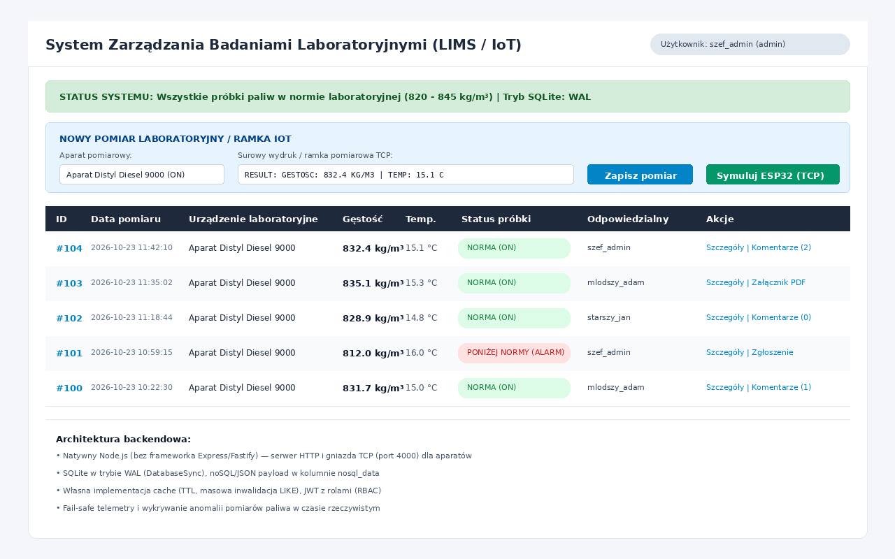

# Laboratorium IoT — Akwizycja i Telemetria Badań Paliw (LIMS)

System klasy **LIMS / IoT** do cyfryzacji pomiarów laboratoryjnych (kontrola jakości oleju napędowego i benzyn). Oprogramowanie integruje fizyczne urządzenia pomiarowe (aparaty laboratoryjne komunikujące się przez mikrokontrolery ESP32 i gniazda TCP) z panelem webowym analityka.

Napisany w **czystym, nowoczesnym Node.js (bez zewnętrznych frameworków webowych — zero zależności `node_modules`)** z wykorzystaniem wbudowanego modułu SQLite w trybie **WAL (Write-Ahead Logging)** i hybrydowego modelu dokumentowego NoSQL.



---

## 🎯 Problem inżynierski

W przemysłowych laboratoriach kontroli jakości (np. paliwa, chemia) aparaty pomiarowe (gęstościomierze, wiskozymetry, aparaty destylacyjne) to często starsze, precyzyjne maszyny z wyjściami szeregowymi (RS-232 / drukarki igłowe). Wyniki były przepisywane ręcznie lub drukowane na papierze.

**Rozwiązanie:**
- Mikrokontrolery **ESP32** przechwytują surowy strumień tekstowy z interfejsu aparatu i przesyłają ramki sieciowe przez **TCP** (port `4000`) do centralnego serwera.
- Serwer weryfikuje token urządzenia, analizuje surowy wydruk elastycznym parserem RegEx odpornym na szumy, klasyfikuje stan próbki (norma vs alarm gęstości) i archiwizuje komplet danych w bazie SQLite.
- Panel analityka umożliwia podgląd w czasie rzeczywistym, dołączanie notatek, audit log oraz telemetryczne alerty o awariach sprzętowych.

---

## 🏛️ Architektura i kluczowe cechy techniczne

### 1. Zero Zależności Zewnętrznych (`zero-dependencies`)
Backend działa wyłącznie na modułach standardowych Node.js:
- `node:http` — autorski lekki router HTTP z obsługą SSR i REST API.
- `node:net` — niskopoziomowy serwer gniazd sieciowych TCP do obsługi transmisji z mikrokontrolerów.
- `node:sqlite` (`DatabaseSync`) — natywna, wbudowana baza danych o wysokiej wydajności.
- `node:crypto` — haszowanie haseł (scrypt, sól per użytkownik, opcjonalny klucz serwera `PASSWORD_PEPPER`), SHA-256 skrótów sesji oraz losowe identyfikatory.
- `node:test` + `node:assert/strict` — wbudowany runner testów jednostkowych.

### 2. Przemysłowy silnik bazy danych (SQLite WAL + NoSQL)
- Baza uruchomiona w trybie **WAL (Write-Ahead Logging)** z timeoutem blokady (`PRAGMA busy_timeout = 5000;`), co zapobiega zakleszczeniom przy równoczesnym zapisie z TCP i odczycie z HTTP.
- **Hybrydowy model danych:** stałe metadane (ID, aparat, użytkownik, znaczniki czasu) w relacyjnych kolumnach SQL; zmienna specyfikacja aparatów, surowy wydruk, statusy i komentarze w strukturze JSON (kolumna `nosql_data`).

### 3. Własny silnik Cache z unieważnianiem LIKE
- Buforowanie widoków w pamięci RAM (`redisLikeCache`) z czasem wygasania (TTL).
- Masowa inwalidacja wzorcem SQL `LIKE` (np. unieważnienie `view_dashboard_%` po dodaniu nowego pomiaru przy zachowaniu szczegółów w pamięci).
- Mechanizm **Cache Bypass** — natychmiastowe ominięcie pamięci podręcznej w przypadku wykrycia awarii krytycznej aparatury.

### 4. Bezpieczeństwo i RBAC (Role-Based Access Control)
- Sesje po stronie serwera: ciasteczko `session_id` (HttpOnly, SameSite=Strict, `Secure` przy `COOKIE_SECURE=true`), w bazie tylko skrót SHA-256 identyfikatora, ważność 8 h, wylogowanie unieważnia sesję natychmiast (`POST /logout`). Każdy POST z innej domeny jest blokowany (403) przez kontrolę `Sec-Fetch-Site`/`Origin`. Rola jest czytana z bazy przy każdym żądaniu.
- Hasła: scrypt + losowa sól per użytkownik; z `PASSWORD_PEPPER` (klucz poza bazą) kradzież samej bazy nie wystarcza do łamania haseł. Stare hashe SHA-256 działają i są podmieniane przy pierwszym logowaniu. **Zmiana lub utrata klucza unieważnia wszystkie hasła.**
- Wcześniej był ręcznie pisany JWT. Zastąpiła go sesja, bo to jedna aplikacja z SSR, a własnej kryptografii nie warto utrzymywać (patrz `docs/STATUS.md`).
- Podział ról:
  - `admin` — zarządzanie personelem i sprzętem,
  - `badacz_super` — pełny wgląd i prawo usuwania dowolnych pomiarów,
  - `badacz` — wprowadzanie danych, edycja i prawo usuwania **wyłącznie własnych badań**,
  - `przegladajacy` — uprawnienia audytora tylko do odczytu.

### 5. Odporność na awarie (Fail-Safe) & Telemetria
- Centralny handler wyjątków (`errorHandler.js`) zapobiegający wyłożeniu procesu.
- Moduł `anomalyMonitor.js` zliczający powtarzające się awarie aparatów w oknach czasowych.

### 6. Logowanie strukturalne (`src/utils/logger.js`)
Własny logger bez zależności: jedna linia JSON na zdarzenie, więc logi da się filtrować (`jq`) zamiast przeszukiwać tekst.
- **`request_id`** – każde żądanie HTTP dostaje ID (lub przejmuje bezpieczny `X-Request-Id` od klienta), zwracane w nagłówku i w błędzie 500. Dzięki `AsyncLocalStorage` trafia do każdego logu z danego żądania, także po `await`.
- **Jedno podsumowanie na żądanie** (`request.completed`): metoda, ścieżka bez query, status, czas; poziom zależy od statusu (5xx → `error`, 4xx → `warn`).
- **TCP/ESP32**: `connection_id`, zdarzenia `frame.saved` / `frame.rejected` z powodem odrzucenia.
- **Bezpieczeństwo**: klucze typu `password`, `token`, `authorization` są maskowane; token urządzenia i login logowane tylko jako krótki hash.
- **Konfiguracja**: `LOG_LEVEL` (`debug|info|warn|error`), `LOG_FORMAT=pretty` dla czytelnego formatu lokalnie.

```bash
node src/http_server.js | jq 'select(.level=="error")'
node src/http_server.js | jq 'select(.request_id=="<id z nagłówka>")'
```

### 7. Powtarzalny pomiar wydajności
Wbudowany skrypt mierzy równolegle obsługę `GET /login` po HTTP keep-alive oraz zapis poprawnych ramek pomiarowych przez TCP. Serwery i seedowane SQLite WAL uruchamiane są dla testu na osobnych portach i tymczasowej bazie; po zakończeniu dane testowe są usuwane. Nie wymaga dodatkowych pakietów.

```bash
npm run perf
# Opcjonalnie: PERF_DURATION_SECONDS=10 PERF_CONCURRENCY=20 npm run perf
```

Lokalny baseline z **czterech uruchomień** (mediana; zakres w nawiasach), Node.js 24.22.0, Linux x64, Intel Core i7-1185G7, 8 logicznych CPU; każde uruchomienie trwało 5 s na scenariusz przy współbieżności 10:

| Scenariusz | Żądania/s (mediana; min–max) | p95 (mediana; min–max) | Błędy |
|---|---:|---:|---:|
| HTTP `GET /login` (keep-alive) | 19 496,7 (16 015,6–21 566,2) | 0,94 ms (0,87–1,08) | 0 |
| TCP: poprawna ramka i zapis pomiaru (nowe połączenie na ramkę) | 7 444,9 (7 230,6–9 133,4) | 1,83 ms (1,62–1,90) | 0 |

To lokalny test pętli zwrotnej, nie gwarancja przepustowości na produkcji: nie obejmuje TLS, sieci zewnętrznej ani wielu procesów/maszyn. HTTP mierzy wyłącznie publiczny widok logowania, a TCP obejmuje walidację tokenu, parsowanie i zapis jednego pomiaru w SQLite. Wyniki służą jako punkt odniesienia do porównań na tym samym sprzęcie.

### 8. Kontrakt danych pomiaru (`src/contracts/measurement.contract.js`)
Jeden plik opisuje, jak wygląda poprawny pomiar: pola, typy, zakresy (gęstość 300–1200 kg/m³, temperatura −50–100 °C), dozwolone statusy i wartość `ERR` dla awarii aparatu. Pełni dwie role:
- **Walidator:** `dbOperations.saveMeasurement()` to jedyna brama zapisu (TCP i HTTP), więc nic niezgodnego z kontraktem nie trafi do bazy. Ramka TCP z błędnymi danymi dostaje `STATUS:INVALID_DATA`, a w logu pojawia się `frame.rejected` z listą naruszeń.
- **Dokumentacja:** `npm run contract` generuje z kontraktu tabelę pól. Osoba z laboratorium może sprawdzić, jakie dane system przyjmuje (np. czy jest wilgotność), bez czytania kodu.

Bez zależności; to ok. 100 linii natywnego JS. Kontrakt obejmuje dokument pomiaru; walidacja surowej ramki ESP32 pozostaje w parserze.

---

## 📁 Struktura projektu

```text
laboratorium-iot/
├── environment/               # Narzędzia DevOps i wdrożeniowe
│   ├── Dockerfile             # Lekki obraz produkcyjny oparty na node:alpine
│   ├── docker-compose.yml     # Konfiguracja środowisk Staging (8080) i Prod (80)
│   └── deploy.sh              # Skrypt wdrożeniowy Zero-Downtime oparty na symlinkach
├── images/
│   └── dashboard.png          # Zrzut ekranu pulpitu LIMS
├── scripts/
│   └── perf-test.js           # Lokalny benchmark HTTP i TCP (bez zależności)
├── src/
│   ├── config/
│   │   └── database.js        # Konfiguracja SQLite (DatabaseSync + WAL mode)
│   ├── contracts/
│   │   └── measurement.contract.js # Kontrakt pomiaru: walidator + generowana dokumentacja
│   ├── controllers/
│   │   ├── lab.controller.js  # Obsługa logowania, formularzy i API
│   │   └── view.controller.js # Server-Side Rendering z buforowaniem Cache
│   ├── middlewares/
│   │   └── auth.middleware.js # Autoryzacja ról (RBAC) na podstawie sesji
│   ├── models/
│   │   └── db.operations.js   # Operacje bazodanowe SQL/NoSQL
│   ├── routes/
│   │   └── app.router.js      # Centralny router żądań HTTP
│   ├── test/
│   │   ├── app.test.js        # Testy automatyczne (prawa dostępu, cache, parser); `session.test.js` (sesje i przepływ HTTP)
│   │   └── logger.test.js     # Testy loggera oraz integracyjny test HTTP
│   ├── utils/
│   │   ├── anomalyMonitor.js  # Telemetria awarii i monitor progów paliwa
│   │   ├── cache.js           # Silnik Cache TTL z obsługą wzorców LIKE
│   │   ├── errorHandler.js    # Globalny system łapania crashów
│   │   ├── session.js         # Sesje w ciasteczku (skrót w SQLite), wygasanie, wylogowanie
│   │   ├── logger.js          # Logowanie JSON, poziomy i korelacja requestów
│   │   ├── parser.js          # Parser surowych wydruków aparatów (RegEx)
│   │   └── uploader.js        # Parser formularzy multipart z załącznikami
│   ├── views/                 # Szablony HTML/CSS oraz obsługa PWA (manifest, sw.js)
│   ├── http_server.js         # Punkt wejściowy serwera aplikacji HTTP
│   ├── tcp_server.js          # Punkt wejściowy serwera gniazd TCP dla IoT
│   ├── mock_esp32.js          # Symulator mikrokontrolera ESP32 z aparatem paliwowym
│   └── seed.js                # Skrypt zasiewania bazy wstępnymi danymi
├── .env.example               # Szablon zmiennych środowiskowych
├── package.json
└── README.md
```

---

## 🚀 Szybki start (lokalnie)

Wymagania: Node.js w wersji **>= 22.0.0** (zawiera `node:sqlite` oraz `node:test`).

### 1. Klonowanie i przygotowanie środowiska
```bash
git clone https://github.com/mptr604-boop/laboratorium-iot.git
cd laboratorium-iot
cp .env.example .env
```

### 2. Inicjalizacja bazy danych (Seed)
```bash
npm run seed
```
Domyślne konta testowe:
- `szef_admin` / `laboratorium2026` (rola: `admin`)
- `starszy_jan` / `laboratorium2026` (rola: `badacz_super`)
- `mlodszy_adam` / `laboratorium2026` (rola: `badacz`)
- `audytor_kowalski` / `laboratorium2026` (rola: `przegladajacy`)

### 3. Uruchomienie testów jednostkowych
```bash
npm test
```
Testy obejmują RBAC, cache, parser, sesje, logger, redakcję danych oraz integracyjny test HTTP. Uruchamia je natywny runner Node.js:
```text
ℹ pass 22 | fail 0
```

### 4. Uruchomienie aplikacji
W jednym oknie terminala uruchom serwer HTTP:
```bash
npm start
```
Aplikacja będzie dostępna pod adresem: **http://localhost:3000**

---

## 📡 Integracja z urządzeniami IoT (ESP32)

W osobnym oknie terminala uruchom serwer nasłuchu gniazd TCP:
```bash
npm run tcp
```
Następnie uruchom emulator mikrokontrolera ESP32, który co 5 sekund wysyła próbkowane dane z aparatu:
```bash
npm run mock:esp32
```

Format ramki przesyłanej przez mikrokontroler:
```text
[START]|<TOKEN_APARATU>|<SUROWY_TEKST_WYDRUKU>|[END]
```

---

## 🐳 Wdrożenie kontenerowe (Docker & Zero-Downtime)

W folderze `environment/` przygotowano skrypty do automatyzacji wdrożenia:

```bash
# Wdrożenie na środowisko stagingowe (port 8080)
sudo bash environment/deploy.sh staging

# Wdrożenie produkcyjne wydania v1 (port 80 z atomowym przepięciem symlinka)
sudo bash environment/deploy.sh production v1

# Rollback kodu z powodem (przed nim powstaje backup bazy)
sudo bash environment/deploy.sh rollback v1 "opis błędu"

# Przywrócenie bazy z backupu (ręczna, świadoma decyzja)
sudo bash environment/deploy.sh restore production backup/production/<plik>.sqlite

# Dziennik wdrożeń (kto, co, kiedy, wynik)
sudo bash environment/deploy.sh journal 20
```

- Backup bazy (`node:sqlite` `backup()`, `integrity_check`, suma SHA-256, retencja 14 dni) powstaje automatycznie przed wdrożeniem produkcyjnym i rollbackiem. Ręcznie: `npm run backup`. Do działania na hoście potrzebny jest Node 24.
- Rollback **nie cofa bazy**: po kilku dniach cofnięcie bazy kasuje nowe dane, więc preferuj poprawkę „w przód”.
- Staging i produkcja mają osobne katalogi danych (`deploy_root/storage/<env>`).
- Uwaga: przepływ Dockera zweryfikowano testami z atrapą `docker`, nie na prawdziwym hoście.

---

## 📜 Licencja

Projekt udostępniony na licencji [MIT](LICENSE). Twórca: **Piotr Miros**.
